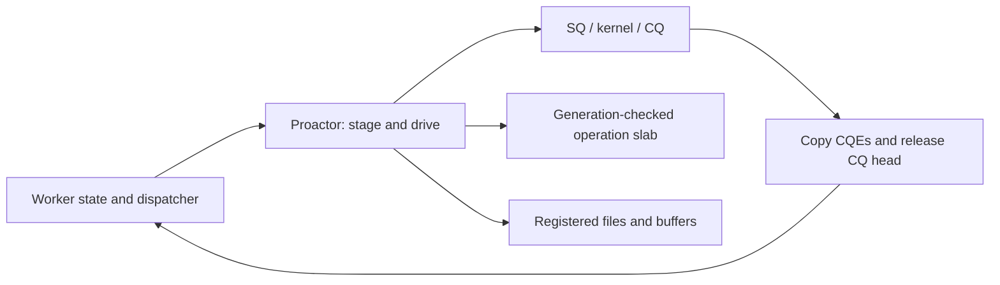

# liburing-cpp

A C++26 single-thread Proactor for completion-driven Linux applications. It uses
native `io_uring` and `futex2` UAPI, C++26 static reflection, and
[`uarch`](https://github.com/trunkszi/uarch) microarchitectural primitives.
Application code uses ordinary `noexcept` calls and explicit state transitions.
There is no executor, coroutine scheduler, exception handling, or RTTI.

[中文说明](README.zh-CN.md)

## Why a caller-owned Proactor?

One worker owns one ring, its operation slab, registered resources, dispatcher,
and business state. Socket, file, timer, and asynchronous futex operations share
that ring. The application decides when to publish work, harvest completions,
and advance its state machines. Completion callbacks run on the issuer thread;
callbacks may stage follow-up operations but must return before driving again.

C++ does not enforce thread confinement in the type system: keep the Proactor
and all its resources on their creating thread. SQPOLL optionally adds a kernel
submission thread; it does not add an application executor.

## Design



Default capacity is 2047 active operations and 255 deferred SQE packs, shared
across subsystems. Large tables live in a startup `mmap` arena. Immediate
submissions encode directly into SQ memory. Completion copy-out is bounded to
16 CQEs per pass, and CQ space is released before callbacks run.

Multishot operations retain slots until the terminal CQE. Zero-copy sends retain
slots and storage through primary and notification completions. Cancellation
requests never release the original operation early. Unknown routes increment
`UnroutedCount()` and report `kNoEntry` after valid routes in that batch run.

## Quick start

```cpp
#include <liburing/liburing.hpp>
using namespace liburing;

enum class Routes : std::uint8_t { kNetwork = 1, kStorage = 2 };
int main() {
  auto engine = Proactor::Builder().Entries(16).Build();
  if (!engine) return 1;
  unsigned completed = 0;
  auto dispatcher = MakeRouteDispatcher<Routes>(completed,
      [](Routes, unsigned& count, const Delivery& delivery) noexcept {
        if (delivery.completion.result == 0) ++count;
      });
  engine->BindDispatcher(dispatcher);
  if (!engine->Arm(1, ops::PrepareNop())) return 2;
  auto progress = engine->WaitCompletions(1, std::chrono::seconds(1), dispatcher);
  auto shutdown = engine->ShutdownWith(dispatcher);
  return progress && shutdown && completed == 1 ? 0 : 3;
}
```

`Build()` returns `std::expected<Proactor, SyscallError>`; operation and loop
methods use `Result<T>` with `UringErrorCode`. `BuildScripted()` provides a
bounded deterministic backend for tests (choose `Entries(8)` or another supported
size up to 64). `SingleDispatcher`, `StaticDispatcher`, and `DynamicDispatcher`
provide single-subsystem, compile-time multi-subsystem, and runtime plugin routing.

## Four execution modes

| Mode | Builder argument | Loop and admission |
| --- | --- | --- |
| EventDriven | `ProactorMode::EventDriven()` | Kernel waits; sockets, files, timers, futexes. |
| SqPoll | `ProactorMode::SqPoll(SqPollConfig{})` | Kernel SQ thread; use nonblocking `Tick`. |
| IoPoll | `ProactorMode::IoPoll()` | Owner polls storage completions; restricted opcode set. |
| SqPollIoPoll | `ProactorMode::SqPollIoPoll(SqPollConfig{})` | Kernel SQ thread plus storage polling. |

`Entries`, `CqEntries`, `Geometry`, `ShutdownStallTimeout`, `SetupFlags`, and
`EnableOptimizations` configure construction. EventDriven negotiates optional
single-issuer/task-work flags with fallback; requested polling modes stay polling
modes. Inspect `Config().mode` and `Backend().Params().flags` for the requested
mode and negotiated kernel flags. A pinned SQ kernel thread cannot share the
owner's sole allowed CPU. Polling modes require optimizations enabled.

IOPOLL admits NOP, read/write variants including fixed buffers and vectored fixed
I/O, and device commands; socket, timer, futex, and cancellation opcodes are
rejected before consuming an operation slot. Actual storage polling requires an
O_DIRECT-capable device/filesystem with polling support.

## Five loop verbs

| Verb | Behavior |
| --- | --- |
| `Submit()` | Replay deferred work and publish/submit; returns newly published SQEs. |
| `PollCompletions(dispatcher)` | Harvest one bounded batch; flush flagged kernel task-work/overflow without submitting pending application SQEs. |
| `WaitCompletions(minimum, timeout, dispatcher)` | EventDriven submit/wait/harvest; minimum must fit the dispatch batch and CQ. |
| `Tick(dispatcher)` | Nonblocking submit/poll/harvest; an idle pass makes no syscall or SQ-tail store. |
| `ShutdownWith(dispatcher)` / `Shutdown()` | Cancel, drain, and close; the latter discards deliveries. |

Busy-poll modes reject blocking waits with `kBusy`; `(0, std::nullopt)` delegates
to `Tick`. Shutdown resets its stall deadline on harvested completions, defaulting
to 320 ms for EventDriven/SqPoll and 5 seconds for storage polling. EventDriven
idle drain waits use slices of at most 10 ms. A timeout leaves ownership pending:
keep borrowed storage alive, continue draining, and use pool quarantine/stall
retention rather than recycling buffers still accessible by the kernel.

## Reflected payloads and routes

```cpp
struct Header { std::uint8_t kind; std::uint16_t flags; std::uint32_t len; };
static_assert(PayloadEncodable<Header>);
constexpr auto encoded = EncodePayload(Header{0xff, 0xffff, 0xffffffff});
static_assert(encoded == 0x00ffffffffffffffULL);
static_assert(DecodePayload<Header>(encoded)->len == 0xffffffffU);
```

Unsigned integer fields pack in declaration order, most significant first, with
an exact total width of 1–56 bits. Signed fields, pointers, enums, `bool`, and
oversized layouts are rejected at compile time. Decoding rejects bits outside
the destination layout. `SubsystemsEnum` proves `uint8_t` route values unique
and excludes reserved IDs 0 and 255. `MakeFnDispatcher` accepts a simple closure.
The payload codec is application metadata: tokens retain their framework-owned
slot/member/subsystem/generation encoding; keep payloads in caller-owned state.

## Owned I/O resources

- `FixedFileTable` allocates direct-descriptor slots. Use `ResourceRegistry` as
  the ring-global partition authority when several subsystems register resources.
- `ProvidedBufferRing` gives selected receive buffers as move-only `BufferLease`.
  Hold a lease through any send that borrows its bytes. Incremental slices recycle
  only after the final kernel slice and all outstanding leases are released.
- `FixedBufferPool::Create(ring, count, length)` owns aligned registered memory.
  `Checkout()` returns a generation-checked handle; `DirectFile::PrepareReadFixed`
  / `PrepareWriteFixed` validates alignment and marks it in flight. Call
  `CompleteInFlight` after the original terminal completion. It reserves the
  ring's complete fixed-buffer table and cannot share that registration with
  another buffer-table owner. Failed admission must also undo buffer tracking.
- `DirectFile::Open(path, DirectAccess::kReadWrite)` requires O_DIRECT;
  `SupportsPolledIo()` queries device polling support before choosing IOPOLL.
- `CompletionSocketIo` owns generation-tagged sockets, selected receives, and
  retained send storage. Use `AdoptSocket`, `Receive(..., ReceiveMode::kMultishot)`,
  `Send` or `SendZeroCopy`, `TranslateBatch`, then `CloseSocket`. Creation rejects
  IOPOLL modes (`kIoPoll` and `kSqPollIoPoll`) with `kInvalid`.

  | Operation | Terminal completion |
  | --- | --- |
  | `Send` | `kSent`, `kFailed`, or `kCancelled`. The fixed send slot is released on that event. `Send` does not emit `kSendReleased`. |
  | `SendZeroCopy` | `kSent` on the primary CQE, then `kSendReleased` after both the primary CQE and `IORING_CQE_F_NOTIF` arrive. A failed or cancelled primary without `IORING_CQE_F_MORE` ends at `kFailed` or `kCancelled`. |
  | `CloseSocket` | `kClosed` after outstanding operations drain. |
  | Connect | `CompletionSocketIo` has no connect operation and does not emit `kConnected`. |

## Kernel coverage

| Category | Subfamilies |
| --- | --- |
| File and storage | read/write and vectored I/O; fixed/direct descriptors; open/close/fsync/stat; filesystem/xattr operations |
| Network | socket/connect/accept/bind/listen; send/recv/message I/O; multishot/provided/bundled receive; zero-copy send/receive |
| Control and resources | NOP/poll/timer; link/cancel/wait; registration/resource tables; device commands and ring geometry |
| Futex and IPC | synchronous Wake; Wait with absolute deadlines; Requeue; WaitAny vectors and asynchronous ring futex operations |

The UAPI mirror covers 65 operation and 38 registration opcode values. Linux
6.16 is the baseline; mixed rings and newer opcodes require the extended kernel
tier. Descriptor availability does not imply hardware/kernel feature support.
`futex2::sync` supports U32 and writable NUMA words, shared scope by default,
MONOTONIC/REALTIME deadlines, NUMA/MPOL flags, and explicit value-change/time-out
outcomes. For example, `futex2::Wait(futex2::MakeRef(word), expected)` requires
unwrapping the checked reference factory result first.

## Build, test, and examples

Reflection-enabled Clang/GCC are required. `uarch` is discovered with
`find_package` through `CMAKE_PREFIX_PATH`, with optional hints at `/root/uarch`
and `/root/.local/vcpkg/uarch`. If that package is missing and
`/root/uarch/CMakeLists.txt` exists, the build adds that source tree. Presets
provide clang/gcc × glibc/musl × release/debug/asan-ubsan. Builds are offline and
compile with `-fno-exceptions -fno-rtti` and warnings as errors.

```sh
./uring test --preset clang-glibc-release
./uring test --preset gcc-musl-release
./uring test --preset clang-glibc-asan-ubsan
./uring tidy
./uring verify all --preset clang-glibc-release
python3 -m unittest discover -s scripts/cli/tests
```

| Runnable executable (`build/<preset>/`) | Demonstrates |
| --- | --- |
| `proactor_subsystems` | One thread, reflected routing/payloads, NOP and timer. |
| `fixed_files_and_buffer_ring_tcp_echo` | TCP loopback direct accept, selected receive, lease-backed echo. |
| `completion_socket_io` | Multishot receive, send events, translation and close. |
| `proactor_modes` | Four builders/loops plus aligned DirectFile/FixedBufferPool transfer. |

All four examples are CTest tests with bounded timeouts. Polling setup failures
caused by unavailable permissions/kernel support are printed explicitly by the
modes example; storage transfers use EventDriven when the device lacks polling.
The O_DIRECT transfer step explicitly skips filesystems that do not support it.
Tier 1 verification audits ABI, instruction shape, and per-symbol LLVM MCA
budgets on three CPU models. Hardware PMU and gem5 Tier 2 gates require their
external runners and fail when unavailable; static checks do not certify them.
