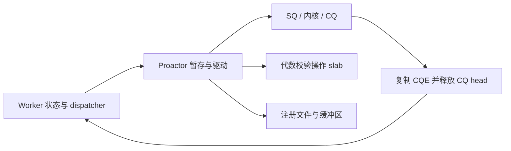

# liburing-cpp

基于 C++26 的 Linux 单线程完成驱动 Proactor，直接使用原生 `io_uring`、
`futex2` UAPI、C++26 静态反射和
[`uarch`](https://github.com/trunkszi/uarch) 微架构原语。
应用通过普通 `noexcept` 调用推进显式状态机，无执行器、协程调度器、异常或 RTTI。

[English](README.md)

## 为什么由调用者持有 Proactor？

每个 worker 独占一个 ring、操作 slab、注册资源、dispatcher 和业务状态。
网络、文件、定时器及异步 futex 可以共用同一线程、同一 Proactor。
应用决定何时提交、收割完成事件以及推进状态机。完成回调运行在 issuer 线程上，
可以暂存后续操作，但必须先返回，才能再次驱动事件循环。

C++ 类型系统不强制线程隔离，请将 Proactor 及其资源留在创建线程。
SQPOLL 可启用内核提交线程；它不会创建应用层执行器。

## 设计



默认提供 2047 个活动操作槽和 255 个延迟 SQE 包，供所有子系统共享。
大表在启动时置于 `mmap` arena；立即提交直接编码到 SQ。
每轮最多复制 16 个 CQE，先释放 CQ 空间，再调用业务回调。

多次完成操作保留槽位直到终态 CQE；零拷贝发送保留槽位和存储直到主完成与通知完成
均已到达。取消请求不会提前释放原操作。未知路由累计到 `UnroutedCount()`，
同批有效路由仍全部交付，随后报告 `kNoEntry`。

## 快速开始

```cpp
#include <liburing/liburing.hpp>
using namespace liburing;

enum class Routes : std::uint8_t { kNetwork = 1, kStorage = 2 };
int main() {
  auto engine = Proactor::Builder().Entries(16).Build();
  if (!engine) return 1;
  unsigned completed = 0;
  auto dispatcher = MakeRouteDispatcher<Routes>(completed,
      [](Routes, unsigned& count, const Delivery& delivery) noexcept {
        if (delivery.completion.result == 0) ++count;
      });
  engine->BindDispatcher(dispatcher);
  if (!engine->Arm(1, ops::PrepareNop())) return 2;
  auto progress = engine->WaitCompletions(1, std::chrono::seconds(1), dispatcher);
  auto shutdown = engine->ShutdownWith(dispatcher);
  return progress && shutdown && completed == 1 ? 0 : 3;
}
```

`Build()` 返回 `std::expected<Proactor, SyscallError>`；操作及循环方法使用
`Result<T>` 与 `UringErrorCode`。测试可用 `BuildScripted()` 构造有界确定性后端
（显式选择 `Entries(8)` 等受支持容量，最大 64）。
`SingleDispatcher`、`StaticDispatcher`、`DynamicDispatcher` 分别提供单子系统、
编译期多子系统及运行时插件路由。

## 四种执行模式

| 模式 | Builder 参数 | 循环与操作准入 |
| --- | --- | --- |
| EventDriven | `ProactorMode::EventDriven()` | 内核等待；支持网络、文件、定时器、futex。 |
| SqPoll | `ProactorMode::SqPoll(SqPollConfig{})` | 内核 SQ 线程；使用非阻塞 `Tick`。 |
| IoPoll | `ProactorMode::IoPoll()` | issuer 轮询存储完成；限制操作集合。 |
| SqPollIoPoll | `ProactorMode::SqPollIoPoll(SqPollConfig{})` | 内核 SQ 线程与存储轮询结合。 |

Builder 支持 `Entries`、`CqEntries`、`Geometry`、`ShutdownStallTimeout`、
`SetupFlags` 和 `EnableOptimizations`。EventDriven 按梯级协商可选的 single-issuer
及 task-work 标志；指定的轮询模式不会静默降级。通过 `Config().mode` 与
`Backend().Params().flags` 检查请求模式及内核协商标志。
指定 SQ 内核线程 CPU 时，不允许它占据 owner 唯一获准使用的 CPU。
轮询模式要求启用优化。

IOPOLL 只准入 NOP、普通/向量/固定缓冲区读写及设备命令；网络、定时器、futex
和取消操作在消耗操作槽前拒绝。实际存储轮询还要求支持 O_DIRECT 且启用轮询的
设备或文件系统。

## 五类循环动词

| 方法 | 行为 |
| --- | --- |
| `Submit()` | 重放延迟操作并发布/提交，返回新发布 SQE 数。 |
| `PollCompletions(dispatcher)` | 收割一批完成；有 task-work/overflow 标志时执行零提交 GETEVENTS。 |
| `WaitCompletions(minimum, timeout, dispatcher)` | EventDriven 提交/等待/收割；minimum 必须适配批次与 CQ 容量。 |
| `Tick(dispatcher)` | 非阻塞提交/轮询/收割；完全空闲时无系统调用和 SQ-tail 原子写。 |
| `ShutdownWith(dispatcher)` / `Shutdown()` | 取消、排空、关闭；后者丢弃业务交付。 |

忙轮询模式对阻塞等待返回 `kBusy`；`(0, std::nullopt)` 等价于 `Tick`。
关闭过程每收割完成事件就重置停滞期限；EventDriven/SqPoll 默认 320 ms，
存储轮询默认 5 秒。EventDriven 排空的空闲等待片段不超过 10 ms。
超时不表示内核已放弃所有权：继续保持借用存储有效、尝试排空，必要时隔离/保留池存储，
不可复用仍被内核访问的缓冲区。

## 反射负载与路由

```cpp
struct Header { std::uint8_t kind; std::uint16_t flags; std::uint32_t len; };
static_assert(PayloadEncodable<Header>);
constexpr auto encoded = EncodePayload(Header{0xff, 0xffff, 0xffffffff});
static_assert(encoded == 0x00ffffffffffffffULL);
static_assert(DecodePayload<Header>(encoded)->len == 0xffffffffU);
```

无符号整数字段按声明顺序从高位到低位打包，总宽度为 1–56 位。
有符号字段、指针、枚举、`bool` 和超宽结构在编译期拒绝。
解码拒绝目标结构位宽之外的非零位。`SubsystemsEnum` 证明 `uint8_t` 路由值唯一，
且不使用保留 ID 0、255；简单回调可用 `MakeFnDispatcher`。
负载编解码器用于应用元数据：框架 token 仍编码槽位、链成员、子系统及代数，
应用负载应保留在调用者状态中。

## I/O 资源所有权

- `FixedFileTable` 分配 direct descriptor 槽位。多子系统分区应统一经过
  ring 全局 `ResourceRegistry` 权威分配。
- `ProvidedBufferRing` 用移动专有 `BufferLease` 暴露内核选择的接收缓冲区。
  借用字节发送时，必须保留租约直到发送完成。增量缓冲区仅在内核末片已到达、
  所有片段租约已释放后回收。
- `FixedBufferPool::Create(ring, count, length)` 持有对齐注册内存。
  `Checkout()` 返回代数句柄；`DirectFile::PrepareReadFixed` / `PrepareWriteFixed`
  校验对齐并标记在途。原操作终态完成后调用 `CompleteInFlight`。
  该池独占整个 ring 的固定缓冲区注册表，不能与其他表所有者共用同一次注册。
  操作准入失败时也应撤销已建立的缓冲区在途记录。
- `DirectFile::Open(path, DirectAccess::kReadWrite)` 要求 O_DIRECT；
  选择 IOPOLL 前用 `SupportsPolledIo()` 检查设备支持。
- `CompletionSocketIo` 持有代数 socket、选择接收环及保留发送存储。
  使用 `AdoptSocket`、`Receive(..., ReceiveMode::kMultishot)`、`Send` /
  `SendZeroCopy`、`TranslateBatch`、`CloseSocket`。创建时拒绝 IOPOLL 模式
  （`kIoPoll` 与 `kSqPollIoPoll`），返回 `kInvalid`。

  | 操作 | 终态完成事件 |
  | --- | --- |
  | `Send` | `kSent`、`kFailed` 或 `kCancelled`。固定发送槽在该事件释放。`Send` 不交付 `kSendReleased`。 |
  | `SendZeroCopy` | 主 CQE 交付 `kSent`；主 CQE 与 `IORING_CQE_F_NOTIF` 都到达后交付 `kSendReleased` 并释放固定发送缓冲区。失败或取消且不带 `IORING_CQE_F_MORE` 的主 CQE 以 `kFailed` 或 `kCancelled` 终止。 |
  | `CloseSocket` | 关联操作排空后交付 `kClosed`。 |
  | Connect | `CompletionSocketIo` 没有 connect 操作，也不交付 `kConnected`。 |

## 内核覆盖

| 类别 | 子族 |
| --- | --- |
| 文件与存储 | 普通/向量读写；固定/direct descriptor；open/close/fsync/stat；文件系统/xattr。 |
| 网络 | socket/connect/accept/bind/listen；send/recv/message；多次完成/选择/批量接收；零拷贝发送/接收。 |
| 控制与资源 | NOP/poll/timer；链接/取消/等待；注册及资源表；设备命令与 ring 几何。 |
| Futex 与 IPC | 同步 Wake；绝对期限 Wait；Requeue；WaitAny 向量及异步 ring futex。 |

UAPI 镜像覆盖 65 个操作和 38 个注册 opcode 值。Linux 6.16 为基线；
混合 ring 及较新操作要求扩展内核能力。描述符存在不代表设备或内核支持该功能。
`futex2::sync` 支持 U32、可写 NUMA word、默认共享 scope、MONOTONIC/REALTIME
绝对期限、NUMA/MPOL 标志和显式值变化/超时结果。调用 Wait 前需先解包
`MakeRef(word)` 的校验结果。

## 构建、测试与示例

需要启用反射的 Clang/GCC。`uarch` 通过 `find_package` 与 `CMAKE_PREFIX_PATH`
查找，可选提示路径为 `/root/uarch` 与 `/root/.local/vcpkg/uarch`。若未找到该包且
存在 `/root/uarch/CMakeLists.txt`，构建会加入这棵源码树。预设覆盖 clang/gcc ×
glibc/musl × release/debug/asan-ubsan；离线构建采用 `-fno-exceptions -fno-rtti`，
警告视为错误。

```sh
./uring test --preset clang-glibc-release
./uring test --preset gcc-musl-release
./uring test --preset clang-glibc-asan-ubsan
./uring tidy
./uring verify all --preset clang-glibc-release
python3 -m unittest discover -s scripts/cli/tests
```

| 可执行示例（`build/<preset>/`） | 内容 |
| --- | --- |
| `proactor_subsystems` | 单线程、反射路由/负载、NOP 和定时器。 |
| `fixed_files_and_buffer_ring_tcp_echo` | TCP loopback direct accept、选择接收、租约发送 echo。 |
| `completion_socket_io` | 多次完成接收、发送事件、批量翻译及关闭。 |
| `proactor_modes` | 四种 builder/循环，以及 DirectFile/FixedBufferPool 对齐传输。 |

四个示例均注册为有超时限制的 CTest。模式示例明确输出权限/内核能力导致的
轮询模式不可用；设备无轮询支持时，存储传输使用 EventDriven。
文件系统不支持 O_DIRECT 时，明确输出原因并跳过该传输步骤。
Tier 1 检查 ABI、指令形状以及三个 CPU 模型下逐符号 LLVM MCA 预算。
硬件 PMU 与 gem5 Tier 2 依赖外部 runner，缺失时失败；静态检查不构成硬件验证。
